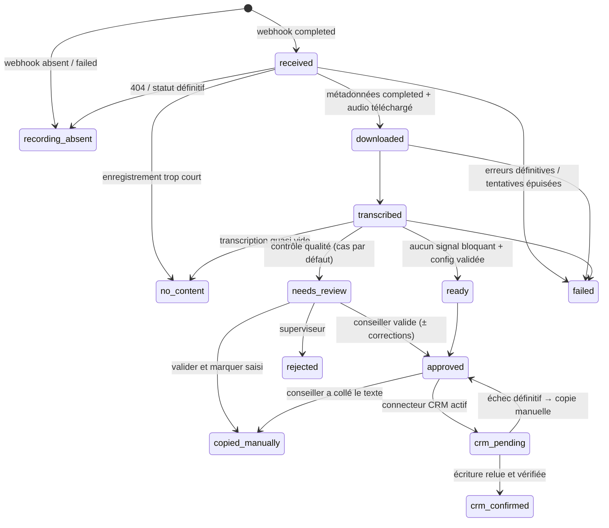

# ARCHITECTURE — Phone Call Agent

## 1. Vue d'ensemble

```mermaid
flowchart LR
    subgraph Twilio
        T1[Appel terminé<br/>enregistrement finalisé]
        T2[(Recordings API)]
    end

    subgraph Agent["Phone Call Agent (serveur)"]
        A["A. Webhook sécurisé<br/>POST /twilio/recording-status<br/>signature + liste blanche + idempotence"]
        H[("H. PostgreSQL<br/>suivi, transcriptions et<br/>comptes rendus chiffrés")]
        C{{"C. File Redis / RQ<br/>workers + nouvelles tentatives"}}
        B["B. Récupération audio<br/>métadonnées → completed ?<br/>téléchargement authentifié"]
        S[("Audio temporaire<br/>chiffré, supprimé<br/>après transcription")]
        D["D. Transcription FR<br/>(interface abstraite)"]
        E["E. Analyse + rédaction IA<br/>sortie JSON structurée<br/>avec justifications"]
        F["F. Validateur<br/>règles explicites → indicateur"]
        I["I. Interface de supervision<br/>relecture, correction, copie"]
        G["G. Connecteur CRM<br/>(désactivé par défaut)"]
    end

    CRM[(CRM interne)]
    U((Conseiller))

    T1 -- "recordingStatusCallback" --> A
    A -- "enregistre l'événement" --> H
    A -- "met en file" --> C
    C --> B
    B -- "HTTP Basic (clé API)" --> T2
    B --> S --> D
    D --> E --> F --> H
    H --> I
    U <--> I
    I -- "validé" --> G
    G -. "uniquement via une interface<br/>officielle et autorisée" .-> CRM
    I -- "sinon : copier / coller" --> U
```

### Cycle de vie d'un appel

## 2. Composants

| Réf. | Composant | Code | Points clés |
|---|---|---|---|
| A | Webhook Twilio | `web/app.py` (`/twilio/recording-status`), `twilio/webhook.py`, `intake.py` | Signature validée par le `RequestValidator` officiel sur l'URL publique configurée ; format strict des SID ; liste blanche d'`AccountSid` ; `RecordingUrl` ignorée ; réponse 204 immédiate, traitement en arrière-plan |
| B | Récupération audio | `twilio/recordings.py`, `storage.py` | Métadonnées d'abord (statut `completed` exigé, durée max) ; téléchargement en flux avec limite de taille, contrôle du `Content-Type` et des octets magiques (MP3/WAV) ; nouvelles tentatives à délai croissant sur 429/5xx/réseau ; 401/403/404 définitifs ; identifiants retirés sur redirection vers un autre domaine ; fichier chiffré (Fernet), permissions 0600, effacé après transcription |
| C | File et workers | `jobs.py` | RQ (Redis) en production : identifiant de tâche unique par appel, 5 tentatives (30 s → 30 min). Mode `inline` réservé au dev/test. Bail (`lease_until`) en base contre le double traitement ; `maintenance` relance les appels bloqués |
| D | Transcription | `transcription/` | Interface `TranscriptionProvider` ; segments horodatés `S1…Sn`, locuteur si fiable, confiance, drapeau `uncertain`, marqueur `[inaudible]` (jamais de texte inventé). Fournisseurs : `simulated`, `faster_whisper` (auto-hébergé, optionnel) |
| E | Génération IA | `generation/` | Interface `ReportGenerator`. Claude via le SDK `anthropic`, sortie **JSON structurée** (schéma strict) ; chaque élément cite ses segments ; faits client / informations conseiller / actions réalisées / actions à faire séparés ; catégorie configurable ou `indetermine` ; prompt versionné dans `prompts/phone_call_v2.md` (en-tête `version:`) ; seules les métadonnées autorisées sont transmises |
| F | Validateur | `quality/validator.py` | Règles explicites (§ 4) ; envoie les cas douteux en validation humaine |
| G | Connecteur CRM | `crm/`, `crm_service.py` | Interface `health_check / find_record / upsert_phone_call / verify_write`. `disabled` par défaut ; `simulated` (dev/test uniquement, refusé ailleurs). Aucun connecteur réel |
| H | Base de suivi | `models.py` | PostgreSQL (SQLite en dev). Transcriptions, comptes rendus et commentaires **chiffrés au repos** |
| I | Supervision | `web/` | Rendu serveur, CSP stricte, rôles, CSRF, journal d'audit, indicateurs, `/metrics` Prometheus |

## 3. Idempotence et nouvelles tentatives

| Niveau | Mécanisme |
|---|---|
| Événement Twilio | `webhook_events.idempotency_key = RecordingSid:RecordingStatus` (contrainte d'unicité) ; les doublons sont comptés (`duplicates`) |
| Appel | `calls.recording_sid` unique : un enregistrement = un traitement |
| File | identifiant de tâche RQ `process-<call_id>` unique |
| Traitement concurrent | bail `lease_until` posé par un `UPDATE … WHERE lease libre` atomique |
| Téléchargement | si l'audio chiffré est présent, il n'est jamais retéléchargé |
| Étapes | chaque étape est validée (commit) séparément : une reprise repart de la dernière étape réussie |
| IA invalide | 2 tentatives immédiates (`PCA_AI_MAX_ATTEMPTS`), puis nouvelles tentatives différées, puis `failed` |
| CRM | clé `sa-phonecall:<RecordingSid>` ; **relecture avant toute nouvelle écriture** ; `confirmed` uniquement après relecture du texte attendu ; issue incertaine (délai dépassé) = `unknown`, jamais `confirmed` |

Erreurs : `TransientError` (réessayée) / `PermanentError` (arrêt immédiat). Chaque échec est enregistré
dans `processing_errors` (étape, tentative, code, message expurgé), sans contenu de conversation.

## 4. Indicateur de qualité (règles explicites, non calibré)

Score = 100 − 40 × (signaux bloquants) − 10 × (avertissements), borné à 0.
**Ce n'est pas une probabilité.** Il sert à trier et à expliquer. Son calibrage (corrélation
avec la note des experts) fait partie du pilote.

| Code | Gravité | Règle |
|---|---|---|
| `empty_text` | bloquant | texte vide |
| `too_long` | bloquant | dépasse `report.max_chars` |
| `too_short` | avertissement | moins de `report.min_chars` |
| `no_content_contradiction` / `content_from_empty_call` | bloquant | incohérence entre « appel inexploitable » et la transcription |
| `missing_evidence` / `unknown_evidence` | bloquant | élément sans justification, ou justification inexistante |
| `asserted_from_uncertain` | bloquant | affirmation (non marquée « à vérifier ») fondée uniquement sur des passages incertains |
| `possible_action_as_done` | bloquant | action « réalisée » dont la justification est une proposition (« je peux vous proposer… ») sans marqueur d'exécution |
| `done_and_todo` | bloquant | même action à la fois réalisée et à faire |
| `unsupported_number` | bloquant | chiffre, montant, date ou quantité écrite absent de la transcription |
| `unknown_category` | bloquant | catégorie hors configuration |
| `category_unsupported` / `category_keywords_absent` | avertissement | catégorie mal justifiée |
| `transcript_low_quality` | avertissement | part de segments incertains > `quality.max_uncertain_ratio` |
| `speakers_unknown` / `speaker_mismatch` | avertissement | attribution client / conseiller douteuse |
| `points_to_verify` | avertissement | l'IA signale des informations à vérifier |
| `internal_reference_in_text`, `personal_data_in_text`, `repetition` | avertissement | hygiène du texte |

Passage en validation humaine si : `quality.always_human_review` (vrai pendant le pilote), OU
configuration métier non validée, OU signal bloquant, OU score < `quality.auto_ready_min_score`.
Un conseiller ne peut valider un compte rendu porteur de signaux bloquants qu'en cochant
explicitement « j'ai vérifié chaque point bloquant » (tracé dans le journal d'audit).

## 5. Modèle de données

| Table | Contenu | Données personnelles |
|---|---|---|
| `calls` | SID Twilio, statut, durée, catégorie, coûts, durées de traitement, bail | aucune (pas de numéro, pas de nom) |
| `webhook_events` | clé d'idempotence, statut, nombre de doublons | aucune |
| `audio_objects` | chemin du fichier chiffré, empreinte SHA-256, taille, dates de suppression | fichier chiffré, effacé après transcription |
| `transcripts` | segments **chiffrés**, nombre de mots, segments incertains | oui (chiffré, purgé selon la politique) |
| `reports` | versions, texte et structure **chiffrés**, indicateur, signaux, jetons, coût | oui (chiffré) |
| `reviews` | validations, corrections (taux de modification), rejets, commentaire chiffré | identifiant du relecteur |
| `crm_writes` | clé d'idempotence, statut, référence externe, vérification | aucune |
| `processing_errors` | étape, tentative, code, message expurgé | aucune |
| `audit_log` | qui a consulté / validé / supprimé / purgé quoi | identifiant des utilisateurs |

## 6. Sécurité

- **Secrets** : uniquement côté serveur, par variables d'environnement injectées par un gestionnaire de secrets ; jamais envoyés au navigateur ; refus de démarrer en `staging`/`production` si la configuration est dangereuse (signature désactivée, fournisseur ou CRM simulé, absence de clé de chiffrement ou de secret de session, file `inline`).
- **Twilio** : clé API restreinte pour l'API REST ; Auth Token réservé à la vérification des signatures ; option *Enforce HTTP Auth on Media URLs* ; aucun accès public permanent aux enregistrements.
- **Chiffrement** : TLS en transit (terminaison sur le reverse proxy), Fernet (AES-128-CBC + HMAC-SHA256) au repos pour l'audio temporaire, les transcriptions, les comptes rendus et les commentaires. Volumes et base chiffrés au niveau de l'infrastructure en complément.
- **Accès** : rôles `advisor` (relire, corriger, valider, copier), `supervisor` (+ rejeter, régénérer, indicateurs, relancer le CRM), `admin` (+ journal d'audit, suppression, purge). L'audio n'est jamais servi par l'application. Toute consultation d'un appel est journalisée. Prototype : comptes locaux (scrypt) et cookie de session signé (`SameSite=Strict`, `Secure`, 8 h), verrouillage après 5 échecs ; **cible : SSO OIDC** de l'entreprise.
- **Web** : CSRF sur tous les formulaires, CSP `default-src 'self'` sans script inline, `X-Frame-Options: DENY`, `Cache-Control: no-store`, pas de documentation OpenAPI exposée.
- **Journaux** : JSON ; identifiants techniques uniquement ; filtre d'expurgation (URL Twilio, identifiants dans les URL, en-têtes d'authentification, clés API, numéros, e-mails) ; `httpx` réduit au niveau WARNING.
- **IA** : pas de numéro, nom ni identifiant technique dans le prompt ; texte de la transcription traité comme une donnée (balises) ; sortie au schéma strict ; gabarits métier rendus en bac à sable Jinja2.

## 7. Conservation et suppression

Paramètres `retention` du fichier métier (valeurs d'exemple, **à valider par le DPO**) :
audio supprimé dès la transcription (au plus tard `audio_hours`), transcriptions purgées après
`transcript_days`, comptes rendus après `report_days`. `python -m phonecall_agent.cli maintenance --loop`
applique la politique et relance les appels bloqués. Suppression complète d'un appel :
interface admin (confirmation « SUPPRIMER ») → `retention.delete_call_data`, tracée dans le journal d'audit.
Suppression chez Twilio : `PCA_TWILIO_DELETE_RECORDING_AFTER_PROCESSING` (désactivé par défaut).

## 8. Remplacer un fournisseur

- **Transcription** : implémenter `TranscriptionProvider.transcribe()` et renvoyer un `TranscriptResult` normalisé (`normalise()`), puis l'ajouter à `build_transcription_provider`.
- **Génération** : implémenter `ReportGenerator.generate()` en renvoyant un `StructuredReport` validé par `parse_structured()`.
- **CRM** : implémenter `CRMConnector` **à partir de la documentation officielle**, puis faire passer les tests de contrat (`tests/test_crm.py`) sur un environnement de recette du CRM avant de l'activer.

## 9. Sous-traitants et flux de données (à compléter avec le DPO)

| Sous-traitant | Données | Finalité | Statut |
|---|---|---|---|
| Twilio | audio, métadonnées d'appel | téléphonie, enregistrement | existant (contrat Sector Alarm à vérifier) |
| Fournisseur de transcription | audio | transcription | **à choisir** (auto-hébergé = pas de sous-traitant) |
| Anthropic (ou cloud partenaire) | texte de la transcription | rédaction du compte rendu | **à valider** : DPA, région, conservation, options de non-conservation |
| Hébergeur | toutes les données stockées | hébergement | **à choisir** |
