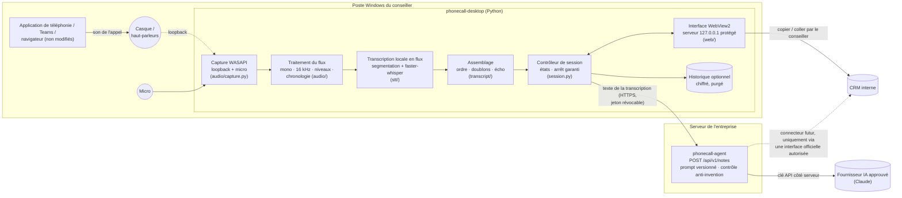
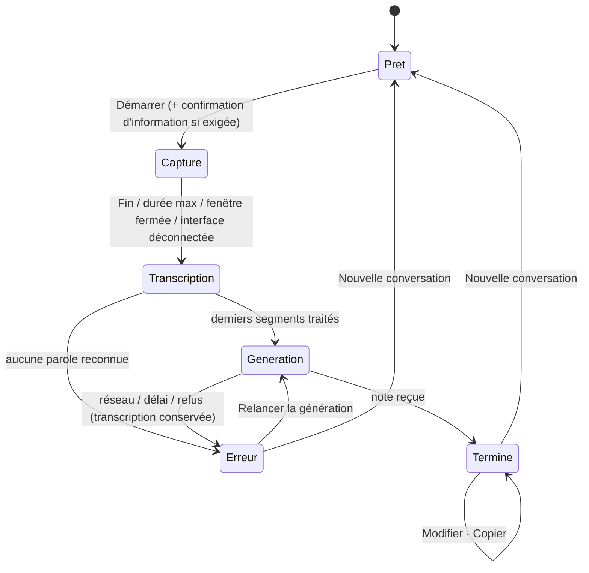

# ARCHITECTURE — Poste conseiller « Phone Call »

## 1. Vue d'ensemble

**Ce qui sort du poste** : uniquement le texte de la transcription, vers la passerelle de
l'entreprise. **L'audio ne quitte jamais le poste** et n'est jamais écrit sur disque.

## 2. Séparation des responsabilités

| Couche | Module | Responsabilité | Testé par |
|---|---|---|---|
| Interface | `web/static/`, `web/server.py` | affichage, actions, sécurité du serveur local | `test_web.py` (API + Playwright) |
| Capture audio | `audio/sources.py`, `audio/devices.py`, `audio/capture.py` | périphériques WASAPI, ouverture, supervision, reprise, arrêt | `test_audio.py` (sources simulées) ; **WASAPI : CI Windows + procédure manuelle** |
| Traitement du flux | `audio/dsp.py`, `audio/timeline.py`, `audio/vad.py` | mono, rééchantillonnage, niveaux, chronologie, détection de voix | `test_audio.py` |
| Transcription | `stt/` | segmentation, partiels/finaux, file, finalisation ; moteur interchangeable | `test_stt.py`, `scripts/benchmark_stt.py` (moteur réel, CI) |
| Assemblage | `transcript/assembler.py` | ordre, idempotence, écho | `test_assembler.py` |
| Génération de la note | `notes/client.py` + passerelle `phonecall-agent` | appel de la passerelle, reprise, délais | `test_notes_client.py` (dont serveur réel), `phonecall-agent/tests/test_notes_api.py` |
| Intégrations externes | passerelle (`phonecall-agent`), CRM abstrait côté serveur | — | — |
| Configuration et sécurité | `config.py`, `secrets_store.py`, `logging_setup.py`, `errors.py` | profils dev/test/production, jeton dans le coffre Windows, journaux expurgés, erreurs centralisées | `test_session.py`, `test_web.py` |
| Supervision | `diag.py`, métriques de session, `--selftest` | diagnostic audio, auto-test | CI Windows |

## 3. Cycle d'une conversation

## 4. Capture audio

- **Deux canaux indépendants** : `system` = son joué par le PC (loopback du périphérique choisi,
  en pratique la voix de l'interlocuteur), `mic` = micro du conseiller. C'est ce qui permet de
  **distinguer les deux interlocuteurs sans reconnaissance vocale de la personne** : on sait
  seulement quel canal a parlé. Les libellés sont « Conseiller » et « Interlocuteur », jamais un nom.
- **Chronologie** : chaque canal est placé sur l'horloge de la session ; les trous du loopback
  (aucun paquet pendant le silence) sont remplis de silence, et le moniteur fait avancer un canal
  muet pour que les phrases se ferment à temps.
- **Supervision** (toutes les 200 ms) : niveau par canal (vu-mètre), alerte « aucun son » après
  10 s, détection d'un flux mort → fermeture, ré-énumération des périphériques, réouverture du même
  périphérique puis du périphérique par défaut, avec délais croissants (0,5 → 8 s).
- **Arrêt** : `stop()` coupe d'abord le drapeau de capture (les rappels audio ignorent toute donnée),
  ferme les flux PortAudio (qui attendent la fin du rappel en cours), vide les files, puis rend la main.
  Fermeture de la fenêtre → `emergency_stop()`. Interface déconnectée plus de 20 s → arrêt. Durée
  maximale (120 min par défaut) → arrêt.

## 5. Transcription en flux

- **Segmentation** (par canal) : détection de voix par énergie avec plancher de bruit adaptatif ;
  une phrase se termine après 0,7 s de silence ou est coupée à 15 s ; 0,3 s de pré-enregistrement
  pour ne pas perdre la première syllabe.
- **Partiels** : toutes les 1,5 s pendant qu'une personne parle, reconnaissance rapide (beam 1)
  affichée en gris italique, remplacée ensuite.
- **Finaux** : reconnaissance complète (beam 5) à la fin de la phrase ; **prioritaires**, jamais
  abandonnés ; jamais modifiés ensuite → pas de doublon ni de réécriture.
- **Partiels abandonnés** si la machine est en retard (la phrase est devenue finale ou un partiel
  plus récent existe) ; le retard est affiché au conseiller (« aucun texte n'est perdu »).
- **Fin** : la phrase en cours devient finale (les derniers mots sont gardés), puis on attend que
  tous les finaux soient reconnus (délai maximal 120 s, sinon avertissement).
- **Hallucinations connues** de Whisper sur le silence (« Sous-titres réalisés par… ») filtrées ;
  segments à faible confiance marqués **incertains** (soulignés), transmis comme tels à la passerelle.
- **Écho** : avec des haut-parleurs, le micro réentend l'interlocuteur. Un segment micro qui
  chevauche (± 1 s) un segment « son du PC » au texte similaire (≥ 60 %) est marqué écho : barré
  dans l'interface, exclu de la note.

## 6. Génération de la note

La passerelle (`phonecall-agent`) reçoit les segments `{start, end, speaker, text, uncertain}`,
numérote S1…Sn, applique le **prompt versionné** `phonecall_agent/prompts/phone_call_v2.md`
(modifiable, en-tête `version:`), obtient une sortie structurée (motif, demande, informations,
actions réalisées, solutions proposées, résultat, actions à faire, points à confirmer, texte final),
puis lance le **contrôle anti-invention** (chiffres et montants absents, proposition présentée
comme réalisée, affirmation sur un passage incertain, appréciation subjective…). Le poste
n'affiche que le **texte libre** et les points à vérifier ; le JSON n'est jamais montré.

`client_request_id` : une nouvelle tentative après coupure réseau renvoie la même réponse (pas
de double coût).

## 7. Sécurité

| Sujet | Mesure |
|---|---|
| Clés d'API | Aucune clé de fournisseur IA sur le poste. Le poste a un **jeton révocable** pour la passerelle, stocké dans le **Gestionnaire d'identification Windows** (keyring) ; seule son empreinte SHA-256 est sur le serveur |
| Transport | HTTPS vers la passerelle (refus d'une URL `http://` en production) ; autorité de certification d'entreprise configurable |
| Serveur local | `127.0.0.1` port aléatoire ; jeton aléatoire par lancement (cookie HttpOnly SameSite=Strict **et** en-tête) ; contrôle `Host` (anti DNS-rebinding) et `Origin` ; WebSocket authentifié ; CSP stricte sans script inline |
| Audio | jamais écrit sur disque, jamais envoyé ; en mémoire le temps de la reconnaissance |
| Transcription / note | en mémoire ; effacées par « Nouvelle conversation » ; historique **désactivé par défaut**, chiffré (Fernet, clé dans le coffre Windows), purgé après 7 jours, transcription non conservée par défaut, suppression unitaire ou totale |
| Journaux | états, durées, codes d'erreur ; filtre d'expurgation (jetons, clés, numéros, e-mails) ; aucun texte de conversation |
| Consentement | case « interlocuteur informé » obligatoire avant « Démarrer » (configurable selon la règle de l'entreprise) |
| Visibilité | bandeau rouge permanent, titre de fenêtre « ● CAPTURE », chronomètre ; touche Échap = arrêt |
| Profils | `production` refuse : sources de test, reconnaisseur simulé, note simulée, passerelle non HTTPS |

## 8. Twilio

Twilio n'est plus requis. Le service `phonecall-agent` continue d'accepter les enregistrements
Twilio (flux existant) et sert, pour le poste, de passerelle IA : les deux sources aboutissent au
même prompt et au même contrôle qualité.
