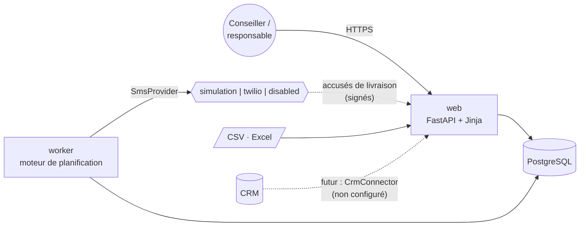
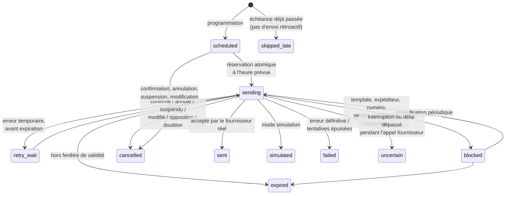
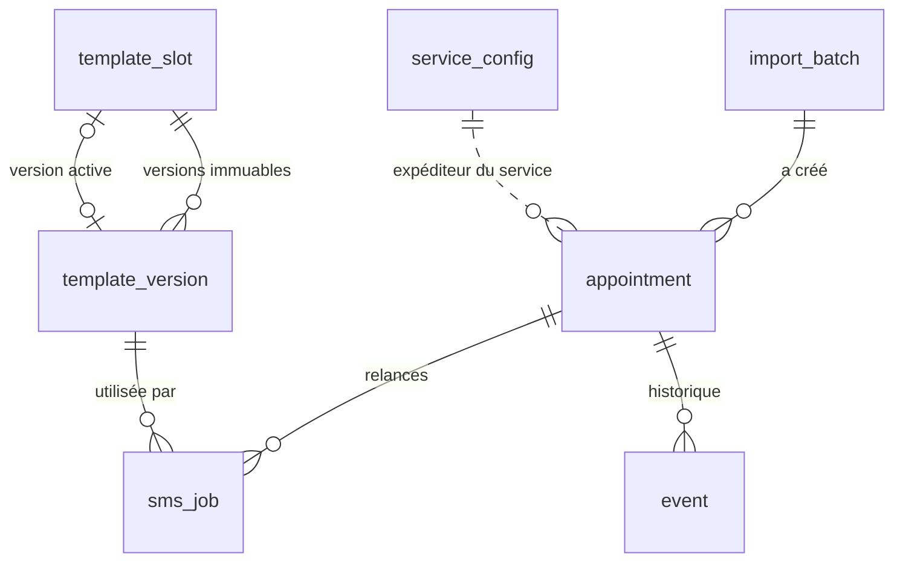

# Architecture

## 1. Choix techniques

Le dépôt contenait déjà une application Python côté serveur (`phonecall-agent/` : FastAPI,
SQLAlchemy, gabarits Jinja, comptes à rôles, CSRF, PostgreSQL). Cette stack convient à un outil
interne de ce type ; elle est reprise pour garder un seul socle à maintenir. L'application
React/Vite à la racine du dépôt (audit Movers) fonctionne entièrement dans le navigateur, ce qui
est incompatible avec des envois programmés : elle n'a pas été utilisée.

| Besoin | Choix |
|---|---|
| Interface web | pages rendues côté serveur (Jinja2), un petit fichier JS sans script inline (CSP stricte) |
| Backend sécurisé | FastAPI, validation côté serveur, sessions signées, CSRF, rôles |
| Base relationnelle | PostgreSQL en production, SQLite pour le développement et les tests |
| Planification persistante | table `sms_job` + processus `worker` (boucle côté serveur), aucune minuterie navigateur |
| Fournisseur SMS interchangeable | interface `SmsProvider` ; implémentations `simulation`, `twilio`, `disabled` |
| CRM | interface `CrmConnector` ; seule implémentation : `DisabledCrm` |

Le `worker` peut tourner en plusieurs exemplaires : chaque tâche est réservée par une mise à
jour atomique (`UPDATE … WHERE status IN (…)`), un seul processus peut l'exécuter.

## 2. Modules

| Module | Rôle |
|---|---|
| `models.py` | tables et vocabulaires (statuts, étapes, services) |
| `policy.py` | politique métier modifiable par un administrateur (délais, fenêtres, reprise, conservation…) |
| `scheduler.py` | planification, contrôles avant envoi, exécution, reprise après incident |
| `appointments.py` | création, modification, confirmation, suspension, annulation, reprise validée, relance manuelle, effacement |
| `importer.py` | lecture CSV/Excel, correspondance des colonnes, validation, aperçu, doublons |
| `templating.py` / `template_admin.py` | variables, validation, rendu, segments ; versions immuables |
| `providers/` | interface fournisseur, simulation, Twilio |
| `crm/` | point d'intégration CRM futur |
| `stats.py` | indicateurs du tableau de bord (définitions explicites) |
| `retention.py` | purge de conservation |
| `web/` | interface, authentification, webhook d'accusés de livraison |

## 3. Cycle de vie d'un SMS

`sent` et `simulated` sont deux statuts distincts, avec en plus la colonne `simulated` : un SMS
simulé ne peut pas être affiché, compté ni filtré comme un SMS envoyé.

### Contrôles effectués juste avant chaque envoi (`scheduler.evaluate`)

Dans cet ordre :
1. plan à jour (le rendez-vous n'a pas été modifié depuis la programmation) ;
2. rendez-vous non annulé, non confirmé, relances non suspendues, pas de reprise en attente ;
3. fenêtre de validité non dépassée et rendez-vous pas trop proche (60 min par défaut) ;
4. aucun SMS de la même étape déjà envoyé récemment (24 h par défaut) ; pour une relance
   manuelle : aucun SMS dans l'intervalle minimal (60 min par défaut) ;
5. envois activés (interrupteur général) ;
6. service renseigné, envois du service actifs, expéditeur du service configuré
   (jamais d'expéditeur par défaut) ;
7. numéro mobile valide, absent de la liste d'opposition ;
8. fournisseur configuré ; pour un fournisseur réel, validation de conformité enregistrée ;
9. template actif, valide, et toutes ses variables renseignées pour ce client ;
10. plage horaire sans envoi (facultative, désactivée par défaut).

### Garanties contre les doublons et les envois tardifs

| Risque | Protection |
|---|---|
| Une étape programmée deux fois (ré-import, double clic, redémarrage) | `sms_job.dedup_key` UNIQUE = `rendez-vous:révision:étape` |
| Deux workers sur la même tâche | réservation atomique ; le second obtient 0 ligne et s'arrête |
| Panne pendant l'appel au fournisseur | `provider_call_started_at` est enregistré **avant** l'appel ; au redémarrage la tâche devient « À vérifier » et n'est jamais renvoyée automatiquement |
| Panne avant l'appel au fournisseur | la tâche est remise en file et toutes les règles sont revérifiées |
| Délai dépassé côté fournisseur (requête peut-être reçue) | statut « À vérifier », pas de nouvelle tentative |
| Rendez-vous déplacé après un SMS | nouvelle révision du plan ; une même étape déjà envoyée dans les 24 h n'est pas renvoyée |
| Envoi en retard après une panne | `expires_at` = heure prévue + fenêtre (60 min par défaut), plafonnée avant le rendez-vous |
| Rendez-vous importé tardivement | les étapes déjà échues sont marquées « Non envoyé (trop tard) » (règle `late_policy=skip`) |
| Confirmation pendant l'envoi | verrou de ligne sur le rendez-vous (PostgreSQL) pendant la vérification |

### Politique de reprise après erreur fournisseur

Erreur temporaire (réseau, 429, 5xx) : nouvelle tentative après 2, 10 puis 30 minutes, au plus
3 tentatives, **uniquement si la nouvelle tentative tombe dans la fenêtre de validité**. Erreur
définitive (numéro invalide, opposition…) : statut « Erreur » ; une opposition signalée par le
fournisseur ajoute le numéro à la liste d'opposition. Tous ces paramètres sont modifiables dans
*Paramètres → Politique de relance*.

### Second SMS de J-1

Deux politiques d'ordonnancement (paramètre `j1_second_anchor`) :
- `scheduled` (défaut) : heure **prévue** du 1er SMS + 3 h → horaire prévisible ;
- `actual_send` : heure **réelle** d'envoi du 1er SMS + 3 h.

### Fuseau horaire

Date et heure saisies sont des heures locales Europe/Paris, converties en UTC à l'enregistrement.
Les relances sont des durées exactes (48 h = 172 800 s). Lors d'un changement d'heure entre la
relance et le rendez-vous, l'heure locale de la relance diffère donc d'une heure de celle du
rendez-vous. Une heure locale inexistante (passage à l'heure d'été) est refusée à l'import ;
une heure ambiguë (passage à l'heure d'hiver) est acceptée avec un avertissement (1re occurrence).

## 4. Confirmation, suspension, reprise

- Cocher « Rendez-vous confirmé » : statut `confirmed`, date, heure, utilisateur et source
  (`team` = confirmation interne) enregistrés ; SMS non envoyés annulés ; le rendez-vous reste
  visible avec tout son historique.
- Décocher : statut « À confirmer » et indicateur « Reprise à valider ». Rien n'est réactivé.
  La fiche affiche, étape par étape, ce que la reprise programmerait (« sera programmé le… »,
  « échéance passée : ne sera pas envoyé ») ; un utilisateur coche une case de validation puis
  confirme.
- Suspension et réactivation d'un rendez-vous annulé suivent le même mécanisme de reprise validée.
- La source `customer_reply` est réservée à une future intégration fiable (réponses SMS ou CRM) ;
  aucune réponse client n'est interprétée aujourd'hui.

## 5. Modèle de données

Schéma SQL complet (PostgreSQL) : [schema.sql](schema.sql) (`python -m sms_reminders.cli schema`).

| Table | Contenu |
|---|---|
| `appointment` | rendez-vous : `customer_ref` (numéro client interne), nom, prénom, téléphone saisi et normalisé E.164, validité du mobile, date et heure locales + instant UTC, service, statut (`active`/`cancelled`) et motif, confirmation (qui, quand, source), suspension et motif, reprise à valider, révision du plan, lot et origine d'import, dernière action. `business_key` UNIQUE : identifiant de rendez-vous CRM s'il est fourni, sinon client + service + date + heure |
| `sms_job` | une relance : étape, révision, `dedup_key` UNIQUE, statut et motif, heure prévue, prochaine évaluation, expiration, tentatives, réservation, heure réelle d'envoi, simulé ou non, fournisseur, identifiant fournisseur, statut de livraison, version du template, expéditeur, destinataire, texte envoyé, segments, erreur |
| `template_slot` | les six emplacements (service × étape) et la version active |
| `template_version` | textes versionnés, jamais modifiés (qui a créé / activé, quand) |
| `service_config` | expéditeur et activation de chaque service |
| `app_setting` | politique de relance (JSON validé) |
| `blocked_number` | liste d'opposition (désinscriptions, numéros interdits, oppositions fournisseur) |
| `event` | historique de chaque action ; les événements d'un rendez-vous sont supprimés avec lui, les événements de sécurité n'ont pas de donnée personnelle |
| `import_batch` | imports : en-têtes, correspondance, résumé ; les lignes brutes sont supprimées dès la validation ou l'abandon (et au plus tard après 24 h) |

Évolutions de schéma : la version actuelle crée les tables au démarrage (`create_all`). Avant la
mise en production, ajouter un outil de migration (Alembic) — voir la check-list.

## 6. Rôles

| Action | Conseiller | Responsable | Administrateur |
|---|:-:|:-:|:-:|
| Consulter tableau de bord, rendez-vous, historique SMS | ✓ | ✓ | ✓ |
| Confirmer / retirer la confirmation, suspendre, valider une reprise, modifier les données | ✓ | ✓ | ✓ |
| Enregistrer une demande de désinscription | ✓ | ✓ | ✓ |
| Importer, créer, annuler / réactiver un rendez-vous, relance manuelle | | ✓ | ✓ |
| Consulter paramètres et templates | | ✓ | ✓ |
| Modifier expéditeurs, templates, politique, conformité ; retirer un numéro de la liste d'opposition ; effacer un rendez-vous ; journal d'audit ; purge | | | ✓ |
